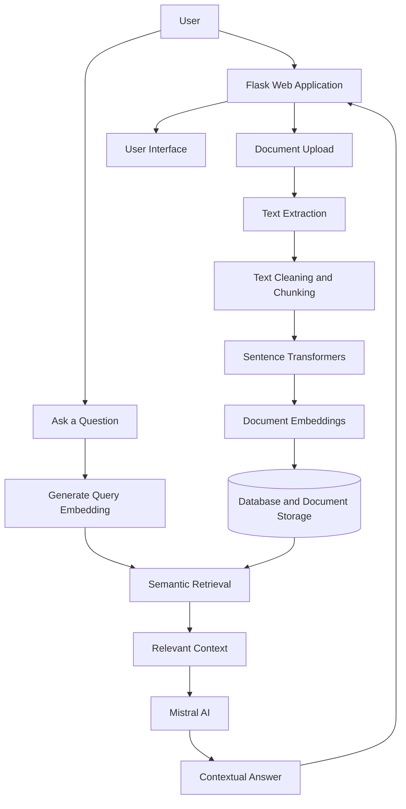

# 🧠 Neural Nexus — AI Knowledge Assistant

**An AI-powered document question-answering system built with Retrieval-Augmented Generation (RAG), Flask, Sentence Transformers, and Mistral AI.**

Neural Nexus is a document-based AI knowledge assistant that helps users interact with their documents through natural-language questions. Instead of manually searching through lengthy files, users can upload supported documents, retrieve relevant information, and receive contextual answers generated by an AI model.

The project combines semantic embeddings, document processing, similarity-based retrieval, and large language models to create a practical AI assistant for personal knowledge management.

🔗 **GitHub Repository:** https://github.com/1616piyu/neural_nexus  
🌐 **Live Demo:** https://neural-nexus-v8c4.onrender.com  
👨‍💻 **Developer:** Piyush Pratap Singh  
🎓 **Background:** B.E. in Artificial Intelligence and Machine Learning

> **Project status:** Deployment and PDF-upload reliability are being improved. The live demo may not support every feature reliably while hosting and memory issues are being resolved.

---

## 📌 Table of Contents

- [Project Overview](#-project-overview)
- [Problem Statement](#-problem-statement)
- [Key Features](#-key-features)
- [How It Works](#-how-it-works)
- [Technology Stack](#-technology-stack)
- [System Architecture](#-system-architecture)
- [Embedding and RAG Pipeline](#-embedding-and-rag-pipeline)
- [Supported Documents](#-supported-documents)
- [Project Structure](#-project-structure)
- [Installation and Setup](#-installation-and-setup)
- [Environment Configuration](#-environment-configuration)
- [Database Configuration](#-database-configuration)
- [Running the Application](#-running-the-application)
- [Testing](#-testing)
- [Deployment](#-deployment)
- [Memory Optimization](#-memory-optimization)
- [Security Considerations](#-security-considerations)
- [Limitations and Future Improvements](#-limitations-and-future-improvements)
- [Learning Outcomes](#-learning-outcomes)
- [Author](#-author)
- [License](#-license)

---

## 🚀 Project Overview

Neural Nexus is an AI-powered knowledge assistant designed to make information inside documents easier to access and understand.

The application uses a Retrieval-Augmented Generation (RAG) approach. It processes document content, divides the extracted text into smaller chunks, generates semantic embeddings, retrieves relevant information, and uses Mistral AI to formulate contextual answers.

The application is built with Python and Flask, with Sentence Transformers providing semantic representations of text. It supports local development with SQLite and a PostgreSQL configuration for hosted deployment.

### Project Goals

- Build a practical AI application using Retrieval-Augmented Generation.
- Enable natural-language interaction with document content.
- Combine semantic search with LLM-based answer generation.
- Implement authentication and persistent conversation data.
- Integrate a relational database into an AI application.
- Optimize model inference for resource-constrained hosting environments.
- Develop experience with backend engineering, NLP, database integration, and deployment.

---

## ❗ Problem Statement

Reading, searching, and extracting information from lengthy documents can be time-consuming. Traditional keyword search can also miss relevant information when the wording of a question differs from the wording in a document.

Neural Nexus addresses this problem by combining semantic retrieval and generative AI.

For example, a user can upload a technical document and ask:

- "What are the main objectives of this document?"
- "Explain the important concepts in simple language."
- "What does the document say about system architecture?"
- "Summarize the key findings."
- "Which section discusses a particular topic?"

The assistant uses retrieved document content to provide a context-aware response rather than relying solely on a general-purpose language model.

**Important:** Answer quality depends on the source document, retrieval quality, available context, and the language model's response.

---

## ✨ Key Features

### 1. Document-Based Question Answering

Upload supported documents and ask questions about their contents using natural language.

### 2. Retrieval-Augmented Generation (RAG)

Combines document retrieval with language-model generation to ground answers in relevant document content.

### 3. Semantic Embeddings

Uses the `sentence-transformers/all-MiniLM-L6-v2` model to represent text as 384-dimensional embedding vectors.

### 4. Contextual AI Responses

Integrates Mistral AI for generating responses using retrieved document context.

### 5. Document Processing

Extracts text from supported file formats, cleans the content, and splits it into smaller chunks for retrieval.

### 6. User Authentication

Provides an authentication layer for user accounts and access to application features.

### 7. Conversation Management

Supports chat-session and message persistence through the application's database layer.

### 8. Database Integration

Supports SQLite for local development and PostgreSQL for hosted deployments.

### 9. Resource-Conscious Inference

Uses lazy model loading, model caching, smaller embedding batches, and a configurable maximum input sequence length to help manage memory consumption.

### 10. Automated Testing

Includes a pytest-based test suite for checking application and service behavior.

---

## ⚙️ How It Works

The document-question-answering workflow follows these stages:

1. **Document upload:** The user uploads a supported document.
2. **Text extraction:** The application extracts readable text from the file.
3. **Text cleaning:** Whitespace and formatting are normalized.
4. **Chunking:** The extracted content is divided into smaller overlapping text segments.
5. **Embedding generation:** Sentence Transformers converts the chunks into numerical vectors.
6. **Storage:** Document information and related data are stored through the application's persistence layer.
7. **Question processing:** The user's question is converted into an embedding.
8. **Semantic retrieval:** Relevant document chunks are selected using similarity calculations.
9. **Context construction:** Retrieved text is assembled into context for the language model.
10. **Answer generation:** Mistral AI generates a response using the available context.
11. **Conversation persistence:** The application stores chat data through its database layer.

### Workflow Diagram



---

## 🛠️ Technology Stack

| Category | Technology |
|---|---|
| Programming language | Python |
| Backend framework | Flask |
| AI architecture | Retrieval-Augmented Generation (RAG) |
| Embedding model | Sentence Transformers — `all-MiniLM-L6-v2` |
| Numerical computation | NumPy |
| Language model | Mistral AI |
| Database | SQLite / PostgreSQL |
| PostgreSQL provider | Neon |
| PDF processing | pypdf |
| Word document processing | python-docx |
| Application server | Gunicorn |
| Configuration | python-dotenv |
| Testing | pytest |
| Source control | Git and GitHub |
| Deployment explored | Render and Google Cloud Run |

The exact implementation of document retrieval and storage depends on the service modules and database configuration in the repository.

---

## 🏗️ System Architecture

Neural Nexus separates application responsibilities into service modules and configuration layers.

### Flask Application Layer

Handles application startup, HTTP routes, user interactions, and coordination between the underlying services.

### Document Processing Layer

Validates uploaded files, extracts text, cleans content, and splits the text into chunks.

### Embedding Layer

Loads the Sentence Transformers model when required and generates normalized numerical vectors.

### Retrieval Layer

Uses embeddings and similarity calculations to identify document content relevant to a user's question.

### LLM Integration Layer

Uses Mistral AI to generate responses from the retrieved context.

### Persistence Layer

Manages application data through SQLite or PostgreSQL, depending on configuration.

---

## 🧠 Embedding and RAG Pipeline

Neural Nexus uses the following embedding model:

**Model:** `sentence-transformers/all-MiniLM-L6-v2`

The model creates 384-dimensional vectors that represent semantic information in text.

### Text Chunking

Document text is divided into smaller sections to make retrieval more manageable.

The current document-processing implementation uses a default chunk size of 1,000 characters and an overlap of 150 characters.

Overlapping chunks help preserve context between adjacent sections.

### Embedding Generation

The application generates normalized embeddings for document chunks and user queries. The vectors are represented using NumPy arrays with `float32` precision.

### Similarity Calculation

The embedding service calculates cosine similarity between the query vector and document vectors.

Conceptually:

\[
\operatorname{similarity}(q,d)=
\frac{q\cdot d}{\|q\|\|d\|}
\]

Here, \(q\) is the query embedding and \(d\) is a document embedding.

Higher similarity generally indicates that two vectors point in more similar directions.

### Contextual Answer Generation

The application passes relevant retrieved content to Mistral AI to generate an answer based on the available context.

### Model Resource Optimization

The embedding service uses:

- Lazy imports to avoid loading Sentence Transformers during initial module import.
- Model caching to avoid repeatedly loading the same model.
- A smaller embedding batch size to reduce temporary memory usage.
- A maximum sequence length of 256 tokens in the optimized configuration.

These changes are intended to reduce memory consumption. They do not eliminate the memory required by PyTorch and the embedding model.

---

## 📄 Supported Documents

The current document-processing service supports:

| Format | Extension |
|---|---|
| PDF | `.pdf` |
| Microsoft Word | `.docx` |
| Plain text | `.txt` |

### Document Validation

The document-processing service enforces a maximum file size of 10 MB and rejects empty or unsupported files.

Encrypted PDFs and documents without readable text may not be processed successfully. Scanned PDFs may require OCR, which is not included in the basic text-extraction workflow.

---

## 📁 Project Structure

The repository separates the Flask application, services, templates, static assets, configuration, and tests.

```text
neural_nexus/
├── app.py
├── config.py
├── database.py
├── requirements.txt
├── .gitignore
├── .env.example
│
├── services/
│   ├── embedding_service.py
│   ├── document_service.py
│   ├── search_service.py
│   └── rag_service.py
│
├── templates/
│   └── ...
│
├── static/
│   └── ...
│
├── uploads/
│   └── ...
│
├── vector_store/
│   └── ...
│
├── data/
│   └── ...
│
└── tests/
    └── ...
```

*This is a representative structure. Keep only the files and directories that actually exist in your repository.*

### Important Files

| File | Responsibility |
|---|---|
| `app.py` | Flask application and routes |
| `config.py` | Environment-based application configuration |
| `database.py` | Database connection and initialization |
| `services/embedding_service.py` | Embedding model and similarity calculations |
| `services/document_service.py` | Document validation, text extraction, and chunking |
| `services/search_service.py` | Document retrieval and search operations |
| `services/rag_service.py` | RAG and language-model integration |
| `requirements.txt` | Python dependencies |
| `tests/` | Automated tests |

---

## 💻 Installation and Setup

### Prerequisites

Install the following:

- Python 3.11 or another Python version supported by your dependencies.
- Git.
- A Mistral AI API key.
- A PostgreSQL database if using PostgreSQL mode; otherwise, SQLite can be used for local development.

### Step 1: Clone the Repository

```bash
git clone https://github.com/1616piyu/neural_nexus.git
cd neural_nexus
```

### Step 2: Create a Virtual Environment

**Windows PowerShell**

```powershell
py -3.11 -m venv .venv
.\.venv\Scripts\Activate.ps1
```

If PowerShell blocks script execution, activate the environment using your preferred supported terminal.

### Step 3: Install Dependencies

```bash
python -m pip install --upgrade pip
pip install -r requirements.txt
```

The Sentence Transformers dependency installs the packages needed by the local embedding model, including PyTorch-related dependencies. The first model load may download model files and require additional memory.

### Step 4: Configure Environment Variables

Create a `.env` file in the project root.

Use the variable names defined by the application configuration and the example below.

---

## 🔐 Environment Configuration

Example `.env` configuration:

```dotenv
FLASK_SECRET_KEY=replace_with_a_random_secret
FLASK_DEBUG=true
FLASK_HOST=127.0.0.1
FLASK_PORT=5000

DATABASE_BACKEND=sqlite
DATABASE_URL=

MISTRAL_API_KEY=replace_with_your_mistral_api_key
MISTRAL_MODEL=mistral-small-latest
```

For PostgreSQL, configure:

```dotenv
DATABASE_BACKEND=postgres
DATABASE_URL=your_postgresql_connection_string
```

Replace the example values with your own credentials.

**Security rules:**

- Never commit `.env` to GitHub.
- Never publish database passwords or API keys in screenshots, issues, or logs.
- Keep `.env.example` free of real secrets.
- Use strong, randomly generated secret keys.
- Configure production secrets using your hosting provider's environment-variable or secret-management interface.

---

## 🗄️ Database Configuration

Neural Nexus supports a local SQLite configuration and a PostgreSQL configuration for hosted deployment.

### Local Development

Set:

```dotenv
DATABASE_BACKEND=sqlite
DATABASE_URL=
```

SQLite is useful for local testing without configuring a separate database server.

### Hosted Deployment

Set:

```dotenv
DATABASE_BACKEND=postgres
DATABASE_URL=your_postgresql_connection_string
```

The project has been configured to use Neon PostgreSQL for hosted deployment.

The application database includes entities for user accounts, chat sessions, messages, documents, document chunks, and embeddings.

The exact persistence behavior depends on the database and service implementation. Keep important uploaded files and any local-only vector data in durable storage when deploying to ephemeral hosting environments.

---

## ▶️ Running the Application

Activate the virtual environment, install the dependencies, and configure `.env`.

Start the Flask application using:

```bash
python app.py
```

If the application is configured for a different startup command, use the command defined by the repository.

Open the local URL printed by the application, commonly:

```text
http://127.0.0.1:5000
```

Create an account or sign in, upload a supported document, and ask a question about its contents.

---

## 🧪 Testing

The project includes a pytest test suite.

Run:

```bash
pytest -q
```

The tests cover the application's implemented behavior and service-level functionality.

Before deploying changes, verify that the tests pass and review the logs for configuration, database, or dependency errors.

For production readiness, test the complete document-upload and question-answering workflow against the configured database and hosting environment.

---

## ☁️ Deployment

The application has been prepared for deployment using Gunicorn and has been tested with Render and Neon PostgreSQL.

### Deployment Configuration

A typical Gunicorn startup command is:

```bash
gunicorn app:app --bind 0.0.0.0:$PORT
```

Use a host-provided port where supported. Confirm that your hosting provider's Python runtime and dependency versions are compatible with the project.

### Environment Variables

Configure these variables in the hosting provider:

- `FLASK_SECRET_KEY`
- `FLASK_DEBUG=false`
- `DATABASE_BACKEND=postgres`
- `DATABASE_URL`
- `MISTRAL_API_KEY`
- `MISTRAL_MODEL=mistral-small-latest`

Never upload `.env` to the hosting provider through GitHub. Enter secret values in the provider's environment or secret settings.

### Memory Requirements

The application uses a local Sentence Transformers model. Its runtime memory requirements include Python, Flask, PyTorch, model weights, document processing, and embedding generation.

A small instance with 512 MB RAM may not be sufficient for reliable PDF processing.

A higher-memory configuration, such as 2 GiB, is a reasonable starting point for testing, although actual requirements depend on workload and concurrency.

### Persistent Storage

Many cloud hosting platforms use ephemeral instance filesystems. Files stored locally may not survive instance replacement or restart.

Use persistent database storage or durable object storage for important documents and other data that must survive redeployment.

### Deployment Links

- GitHub: https://github.com/1616piyu/neural_nexus
- Render: https://neural-nexus-v8c4.onrender.com
- Google Cloud Run: https://cloud.google.com/run

The live application may require further deployment fixes before all features work reliably.

---

## 🧰 Memory Optimization

A key engineering challenge in deploying Neural Nexus is running a local embedding model on a resource-constrained hosting instance.

### Optimizations Implemented

**1. Lazy model loading**

The `SentenceTransformer` import is performed inside `get_embedding_model()` so the heavyweight dependency is not imported during initial module loading.

**2. Model caching**

The model loader uses `lru_cache(maxsize=1)` to reuse the loaded model instead of repeatedly initializing it.

**3. Smaller embedding batches**

The embedding-generation function uses `batch_size=2` to reduce temporary memory usage while processing multiple chunks.

**4. Sequence-length control**

The optimized configuration sets `max_seq_length=256`. Text beyond the effective model input limit may be truncated during embedding generation.

### Remaining Limitations

These optimizations do not reduce the model's weights or remove PyTorch's memory overhead. Large documents, concurrent requests, and PDF extraction may still exceed a small instance's memory limit.

Deployment testing should measure actual memory use during document upload and question answering.

---

## 🔒 Security Considerations

The project is intended as an AI application and learning project. Before using it with sensitive or production data, review the following:

- Protect authentication and session handling.
- Store passwords securely using established password-hashing practices.
- Validate uploaded file types and sizes.
- Protect API keys and database credentials.
- Use HTTPS in production.
- Enforce appropriate user-level access controls.
- Avoid logging sensitive document contents or secrets.
- Configure durable storage and backups for important data.
- Apply rate limits and appropriate request-size limits.
- Review the privacy implications of sending retrieved document text to an external LLM provider.

Do not assume that uploaded documents remain exclusively on your server when external AI APIs are used; the integration's data-handling behavior depends on the provider and configuration.

---

## 🚧 Limitations and Future Improvements

### Current Limitations

- Local embedding inference can consume substantial RAM.
- Scanned PDFs may require OCR.
- Small free hosting instances may terminate workers during document processing.
- Ephemeral filesystems require additional planning for persistent document storage.
- Retrieval and answer quality depend on chunking, embeddings, retrieved context, and model behavior.

### Planned Improvements

- [ ] Improve deployment reliability and memory usage.
- [ ] Add stronger error handling for failed uploads and embedding generation.
- [ ] Improve persistent document and vector storage.
- [ ] Add OCR support for scanned PDFs.
- [ ] Improve retrieval relevance and context selection.
- [ ] Add document-level and user-level access-control tests.
- [ ] Add monitoring for latency, memory usage, and failed requests.
- [ ] Add evaluation datasets for retrieval quality and answer faithfulness.
- [ ] Improve documentation and deployment automation.
- [ ] Add more comprehensive integration tests.

---

## 📚 Learning Outcomes

Building Neural Nexus provides practical experience with:

- Retrieval-Augmented Generation (RAG).
- Natural-language processing and semantic embeddings.
- Sentence Transformers and local model inference.
- LLM integration using Mistral AI.
- Flask application development.
- PDF and document text extraction.
- PostgreSQL and SQLite integration.
- Environment-based application configuration.
- Unit testing with pytest.
- Git and GitHub workflows.
- Deployment troubleshooting and memory optimization.
- The challenges of running AI models in constrained cloud environments.

---

## 👨‍💻 Author

**Piyush Pratap Singh**

B.E. in Artificial Intelligence and Machine Learning

I am interested in AI engineering, Generative AI, RAG systems, backend development, and building practical AI-powered applications.

- **GitHub:** https://github.com/1616piyu
- **LinkedIn:** https://www.linkedin.com/in/piyush-pratap-singh-22995029a/
- **AI Portfolio:** https://ai-portfolio-ncll.vercel.app/
- **Career Agent Project:** https://career-agent-gilt.vercel.app/

For questions, suggestions, or collaboration, connect with me through GitHub or LinkedIn.

---

## 📄 License

No license is specified here. Add a `LICENSE` file to the repository if you want to grant others explicit permission to use, modify, or distribute this project.

---

⭐ If you find this project interesting, consider starring the repository and following my work on GitHub.
